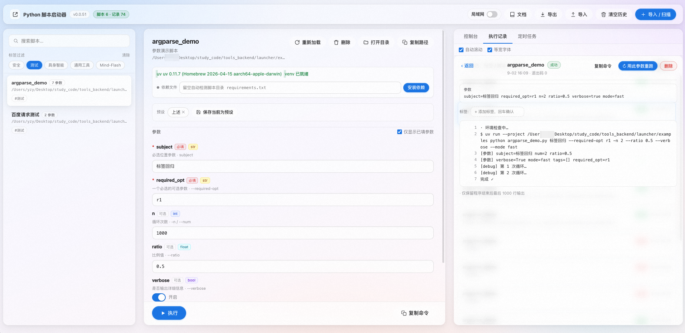

<div align="center">


# Python 脚本启动器

**把「进目录、敲命令、盯输出」变成一张可视化表单 + 一个按钮。**

一个本地运行的脚本启动平台：自动解析 `argparse` 参数生成表单，一键通过 `uv` 在脚本目录运行，实时回显终端输出，并完整留存每次执行记录。

</div>

<p align="center">
  <a href="https://www.python.org"></a>
  <a href="https://fastapi.tiangolo.com"></a>
  <a href="https://docs.astral.sh/uv"></a>
  <a href="https://www.sqlite.org"></a>
  
</p>

---

## 这个项目是做什么的

写脚本工具的人都会反复做同一件事：`cd` 进目录 → 回忆参数名和值 → 手敲一整行 `uv run` 命令 → 盯着终端输出 → 跑完翻找结果文件。**Python 脚本启动器**把这个重复流程固化为一个可视化平台：

- **导入脚本**后自动解析出参数表单（必填置顶、类型识别、描述展示）
- 填好参数**点一下「运行」**，等价于在脚本目录执行那条 `uv run` 命令
- 终端输出**实时流式回显**，带行号、可复制
- 每次执行自动**留存记录**，可加标签、可一键重跑
- 环境交给 uv：每个项目独立 venv，`requirements.txt` / `pyproject.toml` / 单脚本内联依赖都兼容

> 前提约定：你的脚本使用 `argparse` 解析命令行参数即可被自动识别（详见下方「接入你的脚本」）。

---

## 界面一览



> 左侧脚本列表 · 中间参数表单 · 右侧控制台 / 执行记录 / 定时任务

---

## 快速开始

### 环境准备（只需一次，二选一）

**方案 A：安装 [uv](https://docs.astral.sh/uv/)（推荐，Python 包与虚拟环境管理工具）**

```bash
# macOS
brew install uv

# Windows（PowerShell）
powershell -ExecutionPolicy ByPass -c "irm https://astral.sh/uv/install.ps1 | iex"
```

**方案 B：不装 uv，用原生 Python** —— 本工具已完整兼容：`python -m venv .venv` 创建环境、venv 的 pip 装依赖、`.venv/bin/python` 运行脚本（Windows 为 `.venv\Scripts\python.exe`）。脚本目录下只要有 `.venv`（无论是 uv 还是原生 python 创建的）即可直接运行，**无需手动 activate**。

> 理念：**项目目录下有虚拟环境（.venv）或有 uv，就可以运行。**

### 启动

**macOS**：双击 `start.command`（首次自动建 venv、装依赖；服务后台常驻，关闭窗口不影响；已在运行则只打开浏览器）

**Windows**：双击 `start.bat`

或命令行方式：

```bash
cd launcher
uv venv && uv pip install -r requirements.txt
.venv/bin/python main.py --no-browser        # macOS / Linux
# .venv\Scripts\python.exe main.py            # Windows
```

启动后访问 **http://127.0.0.1:8900**（页面右上角有「局域网」开关，打开后同网段设备可访问）。

### 停止

macOS 双击 `stop.command`；Windows 双击 `stop.bat`。无需手动 kill 进程。

---

## 使用文档

页面上方右上角有 **「📖 文档」** 按钮，点击即可在新标签页打开 **10 页 PPT 式演示文档**（支持 ← / → 翻页），直观讲清痛点、运行原理、脚本要求与前提条件：

- 直接访问：`http://127.0.0.1:8900/static/usage.html`
- 或查看源码：[`static/usage.html`](static/usage.html)

---

## 核心功能

| 能力 | 说明 |
|---|---|
| 脚本导入 | 指定 `.py` 路径 / 文件选择器 / 扫描目录批量导入，自动解析 argparse 参数 |
| 参数表单 | 必填置顶、类型彩色标签（int/float/bool/enum/list）、布尔开关、描述显示、自动保存 |
| 参数预设 | 保存 / 覆盖 / 固定常用预设置顶，一键复写表单 |
| 实时控制台 | WebSocket 流式输出（兼容 `\r` 进度条）、行号 + 悬浮复制、多行选择复制、自动滚动 |
| 执行记录 | 完整留存每次输出，支持标签、筛选、多选删除、用旧参数重跑、详情实时输出 |
| uv 环境 | 自动检测 uv / venv，一键初始化 + 安装依赖；兼容 requirements.txt / pyproject.toml / PEP 723 单脚本；**无 uv 时自动降级为原生 python venv（创建/装依赖/运行全兼容）** |
| 定时任务 | 标准 cron 表达式或可视化点选，支持执行次数、参数预设填充、到期自动停用 |
| 多任务 | 同一脚本可并行多次运行，卡片徽章实时显示任务数，独立控制台 |
| 便捷操作 | 打开脚本目录、复制绝对路径、复制 uv run 命令、脚本更新一键重新加载 |
| 数据与安全 | 全部本地 SQLite 存储；删除操作二次确认；命令以参数列表执行（防注入） |

---

## 接入你的脚本（约定）

> **硬性约定：脚本使用 `argparse` 解析命令行参数**，启动器会自动解析参数名、类型、默认值与描述。

```python
import argparse

p = argparse.ArgumentParser(description="我的工具")
p.add_argument("input", help="必选位置参数")                # 位置参数 → 文本框（必填）
p.add_argument("-n", "--num", type=int, default=3)         # int → 数字框
p.add_argument("--ratio", type=float, default=0.5)         # float → 数字框
p.add_argument("--verbose", action="store_true")           # 布尔 → 开关
p.add_argument("--mode", choices=["fast", "slow"])         # choices → 下拉框
p.add_argument("--opt", required=True, help="必选可选参数")  # required → 必填置顶
args = p.parse_args()
```

| argparse 写法 | 表单控件 |
|---|---|
| 位置参数 / 普通 `--opt` | 文本框 |
| `type=int` / `type=float` | 数字输入框 |
| `action="store_true"` | 开关按钮 |
| `choices=[...]` | 下拉框 |
| `action="append"` / `nargs="+"` | 多值输入 |
| `required=True` / 有默认值 | 必填（置顶） |

**单脚本工具**（不想写依赖文件）可在文件头声明内联依赖，uv 直接运行：

```python
# /// script
# requires-python = ">=3.11"
# dependencies = ["fastfeishu>=0.0.1a2"]
# ///
```

---

## 架构与运行原理

**一句话原理：它做的所有事，本质都是帮你正确拼出并在脚本目录执行一条运行命令。**

```
┌──────────┐   argparse AST 解析   ┌──────────┐
│  脚本文件  │ ───────────────────→ │ 参数表单  │
└──────────┘                      └──────────┘
                                        │ 填写参数
                                        ▼
┌──────────┐   拼接命令    ┌────────────────────────┐
│ 执行记录  │ ←────────── │  有 uv：uv run --project │
│ SQLite   │  留存输出     │  <目录> python 脚本.py …  │
└──────────┘              │  无 uv：.venv/bin/python │
                          │  脚本.py …（Win Scripts） │
                          └────────────────────────┘
                                        │ 流式输出
                                        ▼
                              ┌──────────────────────┐
                              │  实时控制台（WebSocket）│
                              └──────────────────────┘
```

> 执行器自动决策：PEP 723 内联脚本走 `uv run --script`；普通项目有 uv 走 `uv run --project`；无 uv 但目录有 `.venv` 走 `.venv` 的 python；两者皆无时明确提示安装 uv 或初始化环境。

### 技术栈

| 层 | 技术 | 职责 |
|---|---|---|
| 后端 | FastAPI + uvicorn | REST API + WebSocket 实时输出 |
| 执行 | uv / subprocess | venv 管理、依赖安装、进程执行（参数列表方式，防注入） |
| 解析 | Python AST + argparse 模型 | 扫描 `.py` 提取参数定义 |
| 存储 | SQLite（`launcher.db`） | 脚本、预设、执行记录、定时任务、偏好 |
| 前端 | 原生 HTML/CSS/JS（内联构建） | 玻璃拟态 UI，无需 Node 构建链 |

### 目录结构

```
launcher/
├── main.py            # FastAPI 后端入口（REST + WebSocket）
├── db.py              # SQLite 数据层
├── scanner.py         # 目录扫描 + argparse AST 解析
├── executor.py        # uv 检测 / venv 管理 / 进程执行 / 流式输出
├── static/            # 前端（index.template.html + app.js + style.css → build 内联）
│   └── usage.html     # PPT 式使用文档
├── assets/            # README 资源（logo / 截图）
├── examples/          # 演示脚本（可删除）
├── build.sh           # 前端构建（内联 JS/CSS 规避缓存）
├── tests_cron.py      # cron 校验与分/时语义回归测试（python -m unittest tests_cron）
├── tests_cron_builder.js # 可视化构建器时/分映射回归测试（node tests_cron_builder.js）
├── start.command      # macOS 启动脚本
├── stop.command       # macOS 停止脚本
├── start.bat          # Windows 启动脚本
├── stop.bat           # Windows 停止脚本
└── launcher.db        # 数据文件（自动生成）
```

---

## 数据与隐私

- 全部数据保存在本地 `launcher.db`，不联网、不上传
- 执行记录仅保留程序结束后的**最后 1000 行**输出，可手动清空
- 命令以 `subprocess` 参数列表执行（不经过 shell），参数值天然防注入
- 局域网访问默认关闭；开启后请仅在可信网络使用

---

## 常见问题

- **提示未检测到 uv** → 页面会给出指引。若脚本目录已有 `.venv`，可正常忽略并运行；两者皆无时可点「初始化环境」用系统 Python 自动创建，或按指引安装 uv（mac: `brew install uv`；win: PowerShell 安装命令），装完点「重新检测」
- **脚本导入失败（422）** → 确认路径为绝对路径、文件存在、脚本使用 argparse 且包含至少一个 `add_argument`
- **依赖装不上** → 确认脚本同目录存在 `requirements.txt` 或 `pyproject.toml`；依赖文件在别处时可在编辑脚本信息中指定路径后点「安装依赖」
- **端口被占用** → 设置环境变量 `LAUNCHER_PORT` 指定其他端口
- **定时任务的时间和预期对不上** → cron 表达式是「分 时 日 月 周」五段：想每天 09:00 执行应写 `0 9 * * *`（不是 `9 0 * * *`）。可视化构建器里的时间选择器会按这个规则自动换算，填完请看下方「下次执行」提示核对；提示会显示具体是哪个字段不合法（例如「时字段取值范围是 0-23」）
